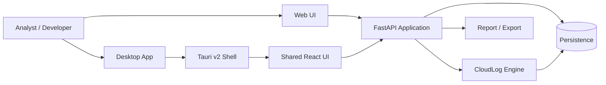
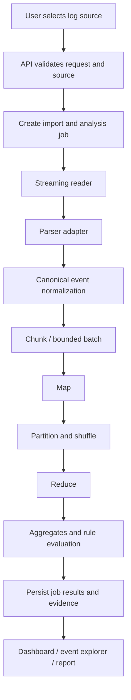

# CloudLog Lens — System Architecture

## 1. Architectural goals

CloudLog Lens is a privacy-first log analytics and security investigation product. The architecture must support:

- Local analysis of large log files without loading an entire source into memory.
- Identical analytical results from sequential and multiprocessing execution.
- A shared web/desktop experience with a stable API boundary.
- Explainable findings backed by source events and rule metadata.
- A later hosted mode without turning the initial product into a distributed microservice system.
- Safe handling of untrusted log content, uploaded files, and workspace data.

## 2. System context

The browser and desktop clients use the same React application and versioned HTTP API. The desktop shell packages the frontend and starts a local Python API sidecar. The engine is a Python library and must not depend on FastAPI, SQLAlchemy, Tauri, or browser code.

## 3. Logical layers and ownership

### Client layer — `frontend`

- React + TypeScript + Vite.
- Tailwind CSS and shadcn/ui design primitives.
- Recharts or ECharts for data visualizations.
- Typed API client, route composition, query/cache state, and accessible interaction patterns.
- No direct database access and no parsing of raw log files as a substitute for backend analysis.

### Desktop host — `desktop`

- Tauri v2 shell around the shared frontend.
- Starts/stops the Python sidecar and manages application lifecycle.
- Uses loopback-only API binding and an ephemeral per-launch authentication secret.
- Owns OS integration (file picker, application data directory, window lifecycle), not product/business logic.
- Never embeds long-lived credentials in the frontend bundle.

### API application — `backend/app`

- FastAPI routers under `/api/v1`, request/response schemas, dependency wiring, authentication/session boundaries, and application services.
- Validates request sizes, paths, identifiers, and workspace access before invoking the engine.
- Coordinates imports and analysis jobs; returns job identifiers for long-running work.
- Emits progress over Server-Sent Events initially. The API must not hold a request open for an entire large analysis.
- Does not contain MapReduce algorithms or parser-specific business logic.

### Processing engine — `engine/src/cloudlog_engine`

A framework-independent Python package with explicit modules:

- `ingestion`: streaming source readers, bounded chunking, encoding policy, and input limits.
- `parsers`: format-specific parsing adapters.
- `normalization`: canonical event conversion and field normalization.
- `mapreduce`: mapper contracts, partitioning, shuffle, reducers, sequential runner, multiprocessing runner, and disk spill.
- `analytics`: reusable aggregations and time-series calculations.
- `detection`: deterministic, explainable rule evaluation and evidence generation.
- `export`: safe machine-readable and human-readable exports.

Engine functions should accept explicit inputs and return typed results. They must not open database sessions, read environment-specific configuration, or import API modules.

### Persistence and migrations

- SQLAlchemy models and repositories live in `backend/cloudlog_api` (or a future explicitly separated persistence package if justified).
- Alembic migration configuration and revisions live under `backend/app/alembic`.
- SQLite is the local/desktop default; PostgreSQL is the hosted target.
- SQLite write access is serialized through one owning application process. Do not let independent worker processes write to the same SQLite database.
- Store normalized events and job state in persistence; use bounded intermediate storage for shuffle/spill and clean it up safely.

### Rules and contracts

- Versioned detection rule definitions live in `rules`.
- Shared API schemas and canonical event contracts are documented and tested independently of UI rendering.
- Rule evaluation is deterministic for a given event set, rule version, and time-window configuration.

## 4. Runtime modes

### Local web mode

A developer runs the API and Vite development server locally. The browser communicates with the API over a configured local origin. Local development may use SQLite.

### Desktop mode

Tauri launches the shared UI and a Python sidecar. The sidecar binds only to loopback, uses a random ephemeral token, and is stopped when the desktop app exits. The desktop host supplies safe file-selection capabilities; the API still validates every path and file.

### Hosted mode (later milestone)

A hosted deployment uses PostgreSQL, explicit user authentication, workspace membership checks, and independently managed background workers. It is not required for the first local MVP. Tenant/workspace isolation must be designed into API service boundaries and database queries before hosted release.

## 5. Core data flow

Required invariants:

1. Source records are consumed incrementally; no full-file read for large inputs.
2. Parsing failures are counted and classified. A malformed row must not silently become a valid event.
3. Canonical event fields have documented types and timezone semantics.
4. Map, shuffle, and reduce stages have observable metrics (records, duration, partitions, spill bytes).
5. Sequential and parallel runners produce equivalent deterministic results.
6. Findings retain rule ID/version, severity, threshold, time window, and evidence references.
7. Findings are investigative signals, never assertions that a host is compromised.

## 6. MapReduce execution design

- A mapper transforms canonical events into key/value pairs.
- Partitioning assigns keys deterministically to reducers.
- Shuffle groups values by key. Large intermediate sets spill to bounded temporary files rather than unbounded RAM.
- Reducers aggregate values and produce typed aggregate records.
- The sequential runner is the reference implementation for correctness.
- The multiprocessing runner uses explicit process boundaries and bounded queues/chunks. Worker processes return results to the owning process; they do not write to SQLite.
- Stage metrics are emitted through a small engine interface so CLI, API, and tests can consume them without framework coupling.
- Temporary spill files use isolated per-job directories, restrictive permissions where supported, and reliable cleanup on success, cancellation, and failure.

## 7. Data ownership (conceptual model)

| Entity | Purpose |
|---|---|
| Workspace | Security and data-isolation boundary |
| User / Membership | Hosted identity and workspace authorization |
| Project | Logical grouping of analysis work |
| Source | Reusable source metadata, not raw credentials |
| Import | One ingestion attempt and its validation statistics |
| Analysis Job | Execution state, configuration, and engine version |
| Log Event | Canonical normalized event |
| Aggregate | Queryable analytical result |
| Finding | Explainable detection result |
| Finding Evidence | Event/aggregate references supporting a finding |
| Job Stage Metric | Map/shuffle/reduce timing and volume |
| Rule Override | Explicit workspace/project tuning |
| Audit Event | Security-relevant administrative action |

This is a conceptual model, not a migration or ORM implementation in this milestone.

## 8. API boundary

- Prefix: `/api/v1`.
- Routers are grouped by resource: health, workspaces, projects, imports, jobs, events, findings, analytics, and exports.
- Pydantic request/response models define the external contract.
- Service functions own orchestration and authorization checks.
- Repositories own persistence queries.
- Long-running operations return a job resource; clients poll or subscribe to progress using SSE.
- API errors use a consistent machine-readable envelope and never expose stack traces, secrets, or raw filesystem paths.

## 9. Security and privacy boundaries

- Treat log lines, filenames, JSON fields, user-supplied regexes, and imported archives as untrusted input.
- Enforce file size, row size, decompression, time, and concurrency limits.
- Prevent path traversal and symlink escapes; use allowlisted file-selection flows in desktop mode.
- Escape log-derived strings in HTML and UI. Never render raw log content as trusted markup.
- Prevent CSV formula injection in exports.
- Use parameterized database queries and workspace-scoped repository methods.
- Redact secrets and sensitive values from logs, errors, and reports.
- No telemetry, automatic upload, external AI API, or IP reputation lookup by default.
- No automatic IP blocking or destructive response action.
- Local API: loopback-only plus ephemeral token; hosted API: real authentication and authorization.

See [Security Model](../security/README.md).

## 10. Observability and failure handling

- Each import and analysis has a correlation/job ID.
- Record stage-level counts, elapsed time, and spill volume without logging raw sensitive payloads.
- Distinguish invalid input, partial parse, cancelled job, engine failure, and persistence failure.
- Jobs must have explicit queued/running/succeeded/failed/cancelled states.
- Cleanup is idempotent and runs after both success and failure.
- Progress reporting is best-effort and must not corrupt analysis if a client disconnects.

## 11. Testing strategy

- Engine unit tests: parsing, normalization, mapper, partitioning, shuffle, reducer, spill, and detection.
- Property/equivalence tests: sequential and multiprocessing output equality across deterministic fixtures.
- Resource tests: bounded memory/chunk sizes and large synthetic inputs.
- API tests: schema validation, authorization boundaries, job lifecycle, upload limits, and error envelopes.
- Persistence tests: migrations and SQLite/PostgreSQL behavior where supported.
- Frontend tests: components, routes, API error/loading/empty states, and accessibility.
- End-to-end tests: import → analyze → findings → evidence → export.
- Security regression tests: traversal, archive bombs, unsafe rendering, CSV injection, and workspace isolation.

## 12. Architecture decision rules

Prefer a dependency only when it removes meaningful complexity and has a maintained, permissively licensed ecosystem. Keep interfaces small. Avoid microservices, message brokers, Kubernetes, and distributed storage in the local MVP. Add hosted infrastructure only when a concrete product requirement needs it.

See [Architecture Decisions](decisions/README.md).
